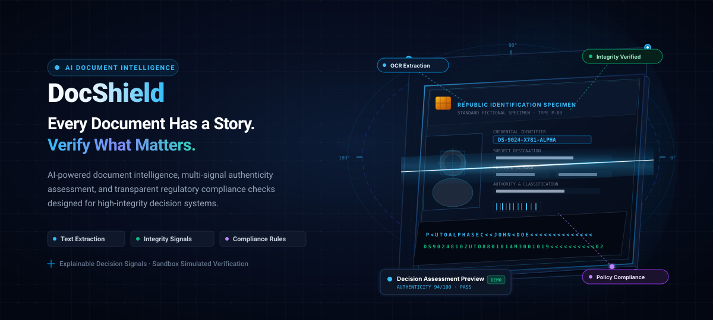
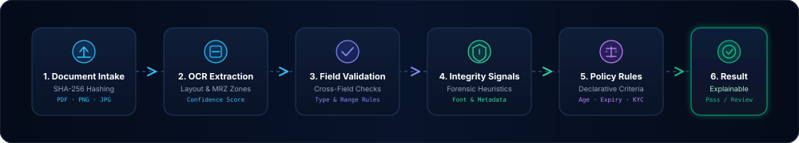
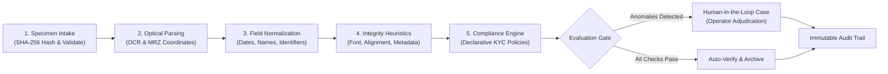
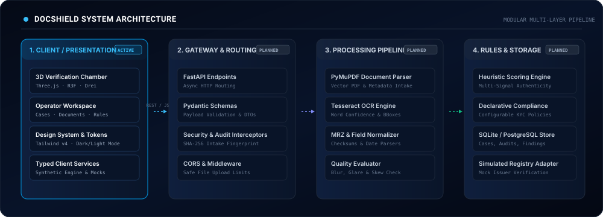

# DocShield

<p align="center">
  
</p>

<p align="center">
  <strong>DocShield</strong> is an enterprise-grade document intelligence and compliance platform engineered to transform static credentials into structured, explainable intelligence through multi-signal authenticity heuristics and declarative policy checks.
</p>

<p align="center">
  <a href="#overview">Overview</a> •
  <a href="#workflow">Workflow</a> •
  <a href="#capabilities">Capabilities</a> •
  <a href="#architecture">Architecture</a> •
  <a href="#tech-stack">Tech Stack</a> •
  <a href="#project-status">Project Status</a> •
  <a href="#getting-started">Getting Started</a> •
  <a href="#responsible-verification">Responsible Verification</a> •
  <a href="#roadmap">Roadmap</a>
</p>

<p align="center">
  
  
  
  
  
  
  
</p>

---

<a id="overview"></a>
## 📋 Project Overview

Modern identity verification and document validation systems frequently suffer from two critical flaws: **opaque black-box AI scores** that cannot explain why a document was flagged, and **fragmented verification pipelines** that treat simple character extraction as proof of authenticity.

**DocShield** addresses these challenges by introducing a structured, multi-tier inspection paradigm:

1. **Extract with Context**: Convert raw pixel arrays and vector PDFs into typed, normalized fields while capturing character-level confidence scores and physical bounding boxes.
2. **Assess Multi-Signal Integrity**: Analyze forensic indicators—such as typographic alignment, metadata creation timestamps, compression artifact boundaries, and Machine Readable Zone (MRZ) checksums.
3. **Enforce Declarative Policy**: Validate extracted credentials against organizational KYC rules, age boundaries, validity periods, and document completeness criteria.
4. **Empower Human Adjudicators**: Synthesize signals into an explainable verification dossier with actionable remediation recommendations for compliance officers and risk analysts.

### Who Benefits from DocShield?

- **Fintech & Digital Banking Operations**: Accelerate customer onboarding while mitigating fraud risks through transparent anomaly detection.
- **HR & Enterprise Workforce Teams**: Validate employee credentials, right-to-work documents, and address recency with standardized audit trails.
- **Compliance & Risk Officers**: Inspect deterministic rule evaluations and maintain immutable event logs for regulatory reporting.
- **Developers & Integrators**: Build upon modular, typed contracts designed for pluggable OCR engines and external registry adapters.

---

<a id="workflow"></a>
## ⚡ The Intelligence Workflow

DocShield separates document processing into six deterministic stages, ensuring that raw optical extraction is never conflated with authoritative authenticity.

<p align="center">
  
</p>

### Pipeline Execution Flow



### Stage Details

| Stage | Operation | Primary Output | Verification Purpose |
| :--- | :--- | :--- | :--- |
| **01. Intake** | File ingestion & SHA-256 checksumming | Digital Fingerprint | Establishes cryptographic chain of custody; prevents duplicate replay attacks. |
| **02. Extraction** | Layout analysis & OCR scanning | Bounding Boxes & Confidence | Parses field entities, dates, labels, and Machine Readable Zones (MRZ). |
| **03. Validation** | Cross-field consistency & formatting | Normalized Entities | Cross-references dates, validates checksum digits, and flags format discrepancies. |
| **04. Integrity** | Forensic heuristic inspection | Multi-Signal Scores | Evaluates metadata generation anomalies, typographical skew, and compression blocks. |
| **05. Compliance** | Policy rule evaluation | Pass/Warn/Fail Matrix | Tests organizational criteria (e.g., minimum legal age 18+, unexpired credential, address recency). |
| **06. Dossier** | Decision synthesis | Explainable Record | Generates an itemized breakdown with remediation hints and manual review escalations. |

> [!IMPORTANT]
> **Trust & Safety Notice**: OCR character extraction only transcribes text; it does not authenticate origin. True authenticity assessment requires multi-signal heuristics, physical inspection, or authorized issuer database validation.

---

<a id="capabilities"></a>
## 🎯 Core Capabilities

DocShield organizes its capabilities into six modular functional areas, clearly delineated between currently implemented features and planned backend extensions:

### 1. Document Intelligence
- **High-Precision Ingestion**: Supports PDF, PNG, and JPEG documents with client-side mime validation and file size constraints. *(Implemented)*
- **Structured OCR Coordinate Mapping**: Captures word-level confidence ratings and visual bounding box overlays for interactive inspection. *(Implemented in UI; Tesseract integration planned)*
- **Dual-Band MRZ Parsing**: Decodes and verifies ICAO Document 9303 checksums for synthetic identity passports and national cards. *(Implemented in Schema)*

### 2. Field Validation
- **Temporal Consistency Checks**: Validates logical date sequences (e.g., Date of Birth precedes Date of Issue; Expiration Date is in the future). *(Implemented)*
- **Identifier Pattern Matching**: Regular-expression format validation for synthetic credential formats. *(Implemented)*
- **Cross-Entity Consistency**: Compares visual text fields with corresponding MRZ machine lines to detect typographical tampering. *(Implemented)*

### 3. Integrity Assessment
- **Digital Metadata Inspection**: Surfaces creation tools, modification timestamps, and PDF producer fingerprints. *(Implemented in Mock Engine; PyMuPDF pipeline planned)*
- **Visual Typography Heuristics**: Detects character alignment variations, font baseline anomalies, and localized compression noise. *(Planned)*
- **Multi-Signal Weighting**: Aggregates categorical signals into an explainable 0–100 authenticity score with transparent deduction reasoning. *(Implemented)*

### 4. Declarative Compliance Rules
- **Configurable KYC Rulesets**: Declarative policy checks including Legal Age (18+), Credential Validity, Mandatory Field Completeness, and Proof-of-Address Recency (≤ 90 days). *(Implemented)*
- **Severity-Tiered Outcomes**: Categorizes policy failures into `BLOCKING`, `WARNING`, and `INFO` to guide human reviewers. *(Implemented)*
- **Custom Policy Management**: Interface for compliance officers to toggle active rules and define organizational risk thresholds. *(Implemented)*

### 5. Explainable Decision Dossier
- **Itemized Signal Breakdown**: Full visibility into each evaluated check, its assigned weight, impact level, and plain-English explanation. *(Implemented)*
- **Actionable Remediation Guidance**: Suggests concrete remediation steps for flagged documents (e.g., "Request higher-resolution specimen; creation date mismatch detected"). *(Implemented)*
- **Audit Export**: Standardized JSON / PDF summary dossier generation for case archives. *(Implemented in Schema; PDF export service planned)*

### 6. Case Adjudication & Audit Trail
- **Human-in-the-Loop Case Queue**: Dedicated operator queue for flagged specimens requiring manual review, escalation, or approval. *(Implemented)*
- **Adjudication Notes & Overrides**: Compliance officers can append dated review notes and record formal adjudication decisions. *(Implemented)*
- **Chronological Audit Logging**: Tamper-evident event log recording actor identity, timestamps, action categories, and system state mutations. *(Implemented)*

---

<a id="architecture"></a>
## 🏛️ System Architecture

DocShield is structured around a decoupled, layered architecture separating user experience from computationally intensive document pipelines and secure persistence stores:

<p align="center">
  
</p>

### Architectural Layers

```text
┌────────────────────────────────────────────────────────────────────────┐
│                        PRESENTATION LAYER (ACTIVE)                     │
│  React 19  │  TypeScript  │  Tailwind CSS v4  │  Three.js / R3F Chamber │
│  Dashboard │  Case Review │  Document Viewer  │  Compliance Policies   │
└───────────────────────────────────┬────────────────────────────────────┘
                                    │ REST / JSON API
┌───────────────────────────────────▼────────────────────────────────────┐
│                      GATEWAY & DTO CONTRACTS (PLANNED)                 │
│  FastAPI Async Router │ Pydantic Schemas │ SHA-256 Intake Interceptor   │
└───────────────────────────────────┬────────────────────────────────────┘
                                    │ Internal Dispatch
         ┌──────────────────────────┴──────────────────────────┐
         ▼                                                     ▼
┌────────────────────────────────┐   ┌──────────────────────────────────┐
│   EXTRACTION PIPELINE (PLANNED)│   │    INTELLIGENCE CORE (PLANNED)   │
│  • PyMuPDF Document Parser     │   │  • Multi-Signal Scoring Engine   │
│  • Tesseract OCR OCR Engine    │   │  • Declarative Compliance Rules  │
│  • MRZ & Checksum Normalizer   │   │  • Simulated Registry Adapters   │
└────────────────┬───────────────┘   └─────────────────┬────────────────┘
                 │                                     │
                 └──────────────────┬──────────────────┘
                                    │
┌───────────────────────────────────▼────────────────────────────────────┐
│                     PERSISTENCE & AUDIT STORE (PLANNED)                │
│  SQLite / PostgreSQL Datastore │ Case Management Records │ Audit Trail │
└────────────────────────────────────────────────────────────────────────┘
```

### Layer Responsibilities

1. **Client / Presentation Layer (Active)**:
   - Built on React 19, TypeScript, and Vite.
   - Houses the **Cinematic 3D Verification Chamber** rendered via Three.js and React Three Fiber, providing interactive spatial visualization of document features.
   - Comprehensive operator dashboard, case adjudication workspace, document viewer, and compliance rule manager.
   - Dual-theme engine supporting responsive dark (midnight navy) and light (clean off-white) interfaces with zero layout shifts.

2. **API Gateway & Contracts Layer (Planned)**:
   - FastAPI asynchronous HTTP framework handling authenticated client traffic.
   - Pydantic models ensuring strict schema validation across document inputs and evaluation results.
   - Cryptographic hashing middleware calculating SHA-256 hashes upon file ingress.

3. **Processing & Extraction Pipeline (Planned)**:
   - `PyMuPDF (fitz)` for PDF vector extraction, metadata parsing, and raster rendering.
   - `Tesseract OCR` for optical character recognition, bounding box generation, and character confidence rating.
   - Specialized parsers for MRZ passport codes and date formats.

4. **Intelligence Core & Rules Engine (Planned)**:
   - Multi-signal heuristic evaluator combining metadata consistency, layout geometry, and simulated issuer responses.
   - Declarative policy engine validating credentials against customizable regulatory criteria.

5. **Persistence & Audit Datastore (Planned)**:
   - Structured relational datastore (SQLite for lightweight development, PostgreSQL for enterprise deployment).
   - Immutable audit log recording all automated evaluations and reviewer decisions.

---

<a id="tech-stack"></a>
## 🛠️ Technology Stack

DocShield strictly separates verified, actively implemented technologies from planned architectural additions:

### Active Frontend Technologies
| Component | Technology | Version | Purpose |
| :--- | :--- | :--- | :--- |
| **Framework** | [React](https://react.dev/) | `^19.3.1` | Declarative component UI and reactive state management |
| **Language** | [TypeScript](https://www.typescriptlang.org/) | `~6.0.3` | End-to-end type safety, interfaces, and DTO contracts |
| **Bundler & Tooling** | [Vite](https://vitejs.dev/) | `^8.3.4` | Ultra-fast HMR dev server and optimized production bundler |
| **3D Rendering** | [Three.js](https://threejs.org/) | `^0.186.1` | WebGL 3D scene graph, materials, shaders, and geometry |
| **3D React Fiber** | [@react-three/fiber](https://docs.pmnd.rs/react-three-fiber) | `^9.8.2` | Declarative React Three.js component bindings |
| **3D Helpers** | [@react-three/drei](https://github.com/pmndrs/drei) | `^10.7.9` | 3D HTML overlays, bevels, and camera controls |
| **Styling** | [Tailwind CSS](https://tailwindcss.com/) | `^4.3.3` | Modern utility CSS with custom dark-variant tokens |
| **Routing** | [React Router](https://reactrouter.com/) | `^7.18.4` | Client-side routing between landing page and dashboard views |
| **Icons** | [Lucide React](https://lucide.dev/) | `^1.60.0` | Accessible, consistent technical icon set |
| **Linter** | [oxlint](https://oxc.rs/) | `^1.88.0` | High-performance Rust-based JavaScript/TypeScript linter |

### Planned Backend & AI Technologies
| Component | Planned Technology | Purpose |
| :--- | :--- | :--- |
| **Web API Framework** | [FastAPI](https://fastapi.tiangolo.com/) (Python 3.10+) | High-performance async REST API with automatic OpenAPI docs |
| **Schema Validation** | [Pydantic v2](https://docs.pydantic.dev/) | Strongly-typed data validation and serialization |
| **Document Processing** | [PyMuPDF](https://pymupdf.readthedocs.io/) | High-speed PDF rendering, structural analysis, and metadata extraction |
| **OCR Engine** | [Tesseract OCR](https://github.com/tesseract-ocr/tesseract) | Optical character recognition with word-level confidence metrics |
| **Database** | [SQLite](https://www.sqlite.org/) / [SQLAlchemy](https://www.sqlalchemy.org/) | Local transactional storage for cases, documents, and audit logs |
| **Test Suite** | [pytest](https://docs.pytest.org/) & [httpx](https://www.python-httpx.org/) | Automated unit, regression, and integration test suite |

---

<a id="project-status"></a>
## 📊 Project Status & Milestone Tracker

| Phase | Milestone | Scope | Status |
| :---: | :--- | :--- | :---: |
| **01** | **Architecture & Blueprint** | System architecture specification, DTOs, and threat model | `COMPLETED` |
| **02** | **Design System & Foundation** | Theme engine, Tailwind v4 design tokens, and layout framework | `COMPLETED` |
| **03** | **Cinematic 3D Landing Page** | Verification chamber hero, scroll story, and editorial brand identity | `COMPLETED` |
| **04** | **Operator Workspace UI** | Dashboard, cases queue, document viewer, and compliance rule views | `COMPLETED` |
| **05** | **Authentication & Access UI** | Login, registration, role selection, and session handling | `IN PROGRESS` |
| **06** | **FastAPI Core & Datastore** | Python backend scaffolding, SQLite database, and Pydantic DTOs | `PLANNED` |
| **07** | **Document Processing Pipeline** | Secure file upload, PyMuPDF parsing, and Tesseract OCR integration | `PLANNED` |
| **08** | **Heuristic Scoring Engine** | Multi-signal authenticity assessment and simulated issuer adapters | `PLANNED` |
| **09** | **Compliance & Adjudication Engine**| Declarative rule evaluation, manual overrides, and audit trails | `PLANNED` |
| **10** | **Reporting & Export Suite** | PDF/JSON verification report generator and end-to-end test suite | `PLANNED` |

---

<a id="getting-started"></a>
## 🚀 Getting Started

### Prerequisites

Ensure the following tools are installed on your workstation:
- **Node.js**: `v18.0.0` or higher (`v20+` recommended)
- **npm**: `v9.0.0` or higher (bundled with Node.js)
- **Git**: `2.30+`

### Frontend Installation & Execution

```bash
# 1. Clone the repository
git clone https://github.com/tanmaylagad45/DOCSHIELD1.git
cd DOCSHIELD1

# 2. Enter the frontend workspace
cd frontend

# 3. Install dependencies
npm install

# 4. Start the local development server with Vite
npm run dev
```

The web application will launch locally at `http://localhost:5173/`.

### Available Scripts

Inside the `frontend/` directory, you can run:

```bash
# Start Vite development server with HMR
npm run dev

# Run TypeScript type check and build production distribution
npm run build

# Run fast code linting with oxlint
npm run lint

# Preview the compiled production build locally
npm run preview
```

### Future Backend Setup (Milestones 6+)

```bash
# Future instructions when backend scaffolding is initiated:
cd backend
python -m venv venv
source venv/bin/activate  # On Windows: venv\Scripts\activate
pip install -r requirements.txt
uvicorn main:app --reload --port 8000
```

---

<a id="responsible-verification"></a>
## 🛡️ Responsible Verification & Safety Disclosures

DocShield is deliberately designed with high standards of technical transparency and compliance ethics:

```text
┌──────────────────────────────────────────────────────────────────────────────┐
│                    SYNTHETIC TESTING & SIMULATION NOTICE                     │
├──────────────────────────────────────────────────────────────────────────────┤
│ 1. OCR Extraction ≠ Authenticity: Optical Character Recognition merely       │
│    transcribes glyphs into digital strings. It does not certify that a       │
│    document is genuine, valid, or issued by an authoritative body.           │
│                                                                              │
│ 2. Heuristics are Decision-Support Signals: Anomaly scores surface           │
│    inconsistencies (such as date mismatches or typographical variance) for   │
│    human investigation. They are not absolute fraud verdicts.                │
│                                                                              │
│ 3. Authoritative Verification Requires Sanctioned Registries: Official       │
│    validation requires direct, legal integration with authorized government  │
│    or institutional registries under appropriate data-protection mandates.   │
│                                                                              │
│ 4. Sandbox Environment: In its current implementation, DocShield operates in │
│    a synthetic demonstration sandbox using synthetic data models.            │
└──────────────────────────────────────────────────────────────────────────────┘
```

- **No Real PII**: The repository does not store or process real government identity numbers, PAN details, Aadhaar credentials, or private citizen information.
- **Explainable by Design**: The platform rejects opaque scoring; every confidence deduction is accompanied by an itemized rationale, impact weight, and remediation hint.
- **Human-in-the-Loop**: Automated rules do not make irreversible real-world decisions without human reviewer oversight and adjudication.

---

<a id="roadmap"></a>
## 🗺️ Product Roadmap

```text
Q1 2026: Foundation & Spatial Visualization
├── [x] Architectural blueprint & core schema definitions
├── [x] Modular UI component library & Tailwind v4 design system
├── [x] Three.js Cinematic Verification Chamber & scroll-driven storytelling
└── [x] Prototyped operator workspace with rich typed mock data

Q2 2026: Authentication & Backend Scaffolding
├── [ ] Secure authentication & role-based access control (RBAC)
├── [ ] FastAPI backend microservice with asynchronous task dispatch
├── [ ] SQLite datastore integration with SQLAlchemy ORM
└── [ ] Secure document ingestion API with cryptographic fingerprinting

Q3 2026: Document Intelligence & Compliance
├── [ ] PyMuPDF document extraction & PDF metadata analysis
├── [ ] Tesseract OCR engine integration with word-level bounding boxes
├── [ ] Multi-signal heuristic scoring engine with MRZ checksum verification
└── [ ] Declarative compliance policy engine with customizable KYC rules

Q4 2026: Enterprise Hardening & Case Management
├── [ ] Real-time reviewer case assignment and collaborative notes
├── [ ] Immutable chronological audit logging with exportable audit packs
├── [ ] Automated PDF/JSON verification dossier export
└── [ ] End-to-end integration test suite and synthetic document benchmark generator
```

---

<a id="contributing"></a>
## 🤝 Contributing

Contributions to DocShield are welcome! To contribute:

1. **Fork the Repository** to your personal GitHub account.
2. **Create a Feature Branch**:
   ```bash
   git checkout -b feature/enhanced-mrz-validator
   ```
3. **Commit Your Changes** using clear, conventional commit messages:
   ```bash
   git commit -m "feat(validator): add ICAO 9303 checksum calculation for TD1 formats"
   ```
4. **Push to Your Branch**:
   ```bash
   git push origin feature/enhanced-mrz-validator
   ```
5. **Open a Pull Request** describing your changes and testing procedures.

---

<a id="license"></a>
## 📄 License

Licensing terms for DocShield are currently under evaluation and yet to be decided. All rights are reserved for demonstration and research purposes until an official open-source license is formally designated.

---

<p align="center">
  <sub>Built with precision for transparent document intelligence.</sub><br />
  <a href="#docshield"><strong>Back to top ↑</strong></a>
</p>
