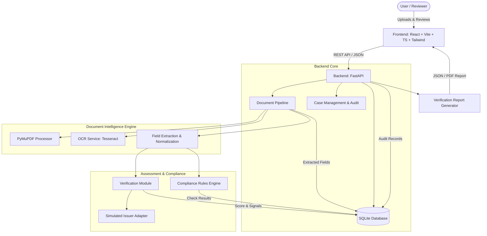

# DocShield — AI-Powered Document Intelligence & Verification Platform


> **DocShield** is an AI-powered document intelligence and verification platform built to provide explainable authenticity scoring, automated OCR and field extraction, regulatory compliance verification, and human-in-the-loop case management.

---

## ⚠️ Synthetic Testing & Simulated Verification Notice

> **IMPORTANT**: DocShield operates in a **simulated sandbox environment** utilizing synthetic test documents and mock registry adapters. 
> - **Simulated results do NOT constitute official government, legal, or institutional verification.**
> - **OCR character confidence alone never establishes that a document is genuine.** True authenticity assessment evaluates multi-signal heuristics (digital metadata, visual layout, font micro-alignment, and registry adapters).

---

## 🌟 Key Features

- **Document Ingestion & Validation**: Safe drag-and-drop file ingestion, client and server-side validation, and SHA-256 integrity hashing.
- **OCR & Field Extraction**: High-precision Optical Character Recognition (OCR) with word-level confidence ratings and visual bounding box overlays.
- **Explainable Authenticity Scoring**: Multi-signal scoring engine breaking down digital metadata integrity, typography consistency, MRZ checksums, and simulated registry status.
- **Declarative Compliance Rules Engine**: Configurable policy checks including legal minimum age (18+), document validity/expiration, mandatory field completeness, and address recency.
- **Human-in-the-Loop Case Management**: Reviewer workspace for adjudicating flagged documents, adding audit notes, and overriding automated decisions.
- **Immutable Audit Trail**: Chronological event logging tracking all system evaluations and manual reviewer actions.
- **Theme Support**: Seamless light and dark mode with persistent user preference.

---

## 🏛️ System Architecture



---

## 📁 Repository Structure

```text
DOCSHIELD1/
├── frontend/                     # React + Vite + TypeScript + Tailwind CSS v4
│   ├── src/
│   │   ├── components/           # UI components (Layout, Common, Upload, Viewer)
│   │   ├── context/              # ThemeContext (dark/light mode)
│   │   ├── pages/                # Dashboard, Documents, Cases, Compliance, Audit
│   │   ├── services/             # Mock datasets and API clients
│   │   ├── types/                # Core TypeScript interfaces
│   │   └── index.css             # Tailwind CSS tokens and glassmorphism utilities
│   ├── package.json
│   ├── tailwind.config.js
│   ├── tsconfig.json
│   └── vite.config.ts
├── backend/                      # Python + FastAPI (Milestones 5–10)
├── sample_data/                  # Synthetic test PDFs and ground-truth schemas
├── .gitignore
└── README.md
```

---

## 🚀 Getting Started

### Prerequisites
- **Node.js** (v18.0.0 or higher)
- **npm** (v9.0.0 or higher)

### Running the Frontend
```bash
# Navigate to the frontend directory
cd frontend

# Install dependencies
npm install

# Start the Vite local development server
npm run dev
```

The application will be accessible at `http://localhost:5173/`.

---

## 🗺️ Implementation Roadmap

- [x] **Milestone 1**: Project Planning, Architecture Blueprint & Specification
- [x] **Milestone 2**: Frontend Foundation, Design System, Theme Engine & Component Framework
- [ ] **Milestone 3**: Backend Scaffolding with FastAPI, SQLite Database & Pydantic Models
- [ ] **Milestone 4**: Secure Document Ingestion API & Local Storage Management
- [ ] **Milestone 5**: PyMuPDF Document Pipeline & Tesseract OCR Integration
- [ ] **Milestone 6**: Explainable Authenticity Scoring Engine & Simulated Issuer Adapter
- [ ] **Milestone 7**: Declarative Regulatory Compliance Rules Engine
- [ ] **Milestone 8**: End-to-End Case Management & Audit Trail Integration
- [ ] **Milestone 9**: Verification Reports Generation (PDF/JSON) & Automated Pytest Suite

---

## 🛡️ License

This project is licensed under the MIT License — designed for educational and demonstration purposes.
